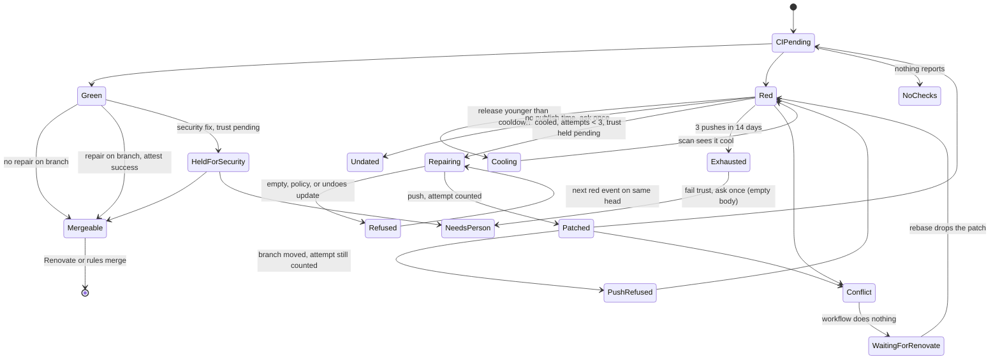

# Implicit state machines in ivy/almanac, 2026-11-09

An audit of every lifecycle in [ivy/almanac](https://github.com/ivy/almanac) at `b8bdefa` (the rev this repo pins) whose state is spread across flags, rows, strings, or GitHub rather than held in one named type with one place that moves it. [The brined-almanac half](2026-11-09-state-machines-brined.md) covers this repo. [The recommendations](2026-11-09-state-machines-recommendations.md) are separate.

How it was gathered: four read-only subagents each took one layer (core runtime, store and broker, providers and fakes, the Renovate almanac), and a fifth took brined-almanac. I re-read the code behind every claim marked **verified**. **Traced** means a subagent followed it in code and I did not re-check it. **Suspected** means it needs a runtime check. Nothing was run. Paths are relative to the almanac repo root, and line numbers are approximate.

## The pattern in one paragraph

Almanac is careful at its boundaries. `Admission`, `Ingest`, `Claim`, `EntryStatus`, `Age`/`Cooled`, the taint types, `Purpose`/`Egress`, simforge's `Fate`, and `fleet::derive` are explicit types, and they are among the best-tested code in the repo. The lifecycles behind those types are not explicit. A run, an outbox entry, a sandbox, a repair on a pull request, and a trust status each have a happy path that is clear in the code, and failure states that are missing, silent, or have no way out. Four problems recur in nearly every machine below:

1. **Dead-end states.** A run left `running`, an outbox entry `failed`, a trust status left `pending`, a leaked container, a pull request no workflow will touch again. No transition leads out of them and nobody is told.
2. **Counting plans instead of outcomes.** Attempt caps, the asked-once flag, and chain depth are derived from traces of *planned* effects, written when a run ends, before delivery succeeds. The trace kind is a `Debug` string.
3. **Fakes that run a different machine.** The memory store, `FakeSandbox`, and simforge skip transitions that their real counterparts have. Principle 11 makes the fakes the test oracle, so those transitions go untested.
4. **No view of the current state.** There is no status verb. The consumer throws away ingest and settle results, and the only `tracing` calls in the provider crates are two warnings in sandbox abandon.

## Core runtime

### Key slot: one active run per key

- **Where:** set membership across `pending`, `runs.status` and `outbox.status`, combined in `is_free` (`crates/almanac/src/store/memory.rs:67`). Admission is at `crates/almanac/src/runtime.rs:395-425`. The partial unique index on active runs is tested at DB level and done well.
- **States:** free, queued, running, running with a queued follow-up (coalesced), and blocked on a pending outbox entry.
- **Gap (traced):** a `failed` outbox entry frees the key (`memory.rs:62-71`), so a give-up quietly unblocks the next run with no record that the last effect never landed.

### Run lifecycle and outcome

- **Where:** `runs.status` has two values, `running` and then `finished` or `interrupted` (`crates/almanac/src/store/postgres.rs:295,324`). Ran, Stopped and Failed exist only in memory as `Outcome` (`runtime.rs:133-156`), and `release` takes no outcome.
- **States as seen by the store:** pending, running, finished, interrupted. Failed and stopped runs are stored as `finished`.
- **Dead end (verified):** in `Runtime::work` (`runtime.rs:525-557`), `self.workflow(&run.workflow)?`, `planned(&outcome)?`, `self.store.release(...).await?` and `self.remember_effects(...).await?` all return early. Any store error after a run starts leaves the row `running`. `recover()` is called only at daemon startup (`crates/almanac/src/app.rs:196`, verified by grep), and `daemon::run` retries `follow` without it. The key stays blocked until the process restarts. The DB-outage test only cuts the database while the daemon is idle.
- **No attempt cap on recovery (traced):** `recover` requeues every `running` row as a new run id with no counter. A payload that crashes the process loops across restarts until the hourly budget stops it, which principle 6 rules out. The new run id also orphans the old run's `run_log`, so the requeued run calls the model again and pays again.
- **No owner (suspected):** `recover` requeues every running row, so a second daemon on the same database requeues the first one's live runs.
- **Late release (traced):** `release_tx` ignores `rows_affected`, so a release that arrives after `recover` still writes effects.

### Outbox entry

- **Where:** `EntryStatus` is explicit: Pending, Applied, WouldApply, Failed (`crates/almanac/src/store/mod.rs:107`), with a DB CHECK constraint. Transitions are at `runtime.rs:635-653` and in each store.
- **Terminal states are not terminal (verified):** `delivered` is `UPDATE outbox SET status = 'applied' ... WHERE key = $1 AND almanac = $2`, and `delivery_failed` updates `attempts` and `status` with the same unguarded `WHERE` (`postgres.rs:543-578`). Neither checks the current status, so a late success can flip `failed` to `applied` and a late failure can bump an applied entry's attempt count.
- **Silent give-up (traced):** after five attempts the entry becomes `failed`. Attempts happen once per settle wake, with no backoff. `last_error` is written and never read, and nothing is logged.
- **Duplicated rule:** the give-up rule is implemented separately in `memory.rs` and `postgres.rs:568`.

### Budgets and the trip latch

- **Where:** a count of `runs.started_at` in the window, the `tripped.tripped_at` latch, and a `'*'` sentinel for the overall cap (`runtime.rs:427-441, 538-546, 588-604`).
- **Non-atomic alert (traced):** the latch commits inside `claim`, and the alert is written afterwards by `ask_about_budget`. If that write fails, the trip is recorded and nobody is asked for that window. Without an `alerts` target the trip is invisible, because it isn't logged.

### Chain depth, attempts, and asked-once (the ledger)

- **Where:** `ledger` rows (`Trace { kind, depth, at }`) keyed by workflow and key. Depth uses a 2-hour window (`runtime.rs:386-393`). Attempts and asked-once use a 14-day window (`crates/almanac/src/cx.rs:238-252`).
- **Plans, not outcomes (verified):** `remember_effects` (`runtime.rs:562-578`) writes one trace per non-Await effect in live mode as the run ends, before the outbox delivers anything. `Cx::attempts` counts `kind == "Push"` as `used` and any `"Ask"` as `asked`. A push that the forge refuses, or an ask that fails five times, still counts.
- **Stringly typed (verified):** `kind: format!("{:?}", effect.kind())` is compared against the literals `"Push"` and `"Ask"`. Renaming an `EffectKind` variant would zero the attempt cap without failing a build.
- **Non-atomic (traced):** `release` and `remember_effects` are separate writes. A crash between them loses the trace, which weakens both the depth bound and the attempt cap.

### Trust-status hold

- **Where:** a GitHub commit status, posted by `Cx::hold` (`cx.rs:254-280`) outside the outbox, because it has to land before the agent starts.
- **States:** none, then pending, then success or failure.
- **Dead end (traced):** `build_failures` holds, then reads logs, then runs the agent. If anything after the hold fails, the run ends `Failed` with no `Attest` effect, and GitHub keeps `pending` on that SHA. That blocks the merge, which is the safe direction, but nothing clears it until a scan sees the stale hold. Only the crash case is tested (`crates/definitions/tests/daemon.rs:183`).

### Daemon lifecycle

- **Where:** `Runtime.stopped`, `Health`, and two watch channels (`crates/almanac/src/daemon.rs:87-166`, `app.rs:154-202`).
- **States:** connecting, recovering, running, reconnecting, stopping, abandoning.
- **Grace (suspected):** on stop the in-flight future is dropped after `GRACE` = 30s, and a sandboxed agent run can last longer. Health can also stay false after a failed ping when `follow` then succeeds.

### Scan scheduler and backfill

- `tick` sets `last_scan` before it scans (`runtime.rs:765-772`), so a failed scan waits a full interval (15 minutes by default) before it retries.
- `Backfill.queued` counts Echo, ChainStopped, Unrouted and Ignored as queued (`runtime.rs:752-756`).
- `Scanned::at_state` (`crates/almanac/src/workflow.rs:86-92`) is the framework's tool for moving a scanned subject to a new state: it appends `~{state}` to the delivery id, so "same subject, new state" gets a fresh id. Renovate uses it (`cooled=…,held=…`). It is the right fix for the brined cluster bug.

### Mode

- `ALMANAC_MODE` must be exactly `live` (verified, `app.rs:94-99`). Any other value, including `Live` or a typo, runs dry with no warning, and the "running" log line doesn't name the mode.
- `Mode::scope` keeps dry-run rows apart from live ones, which is done well.
- `backfill` and `simulate` fall back to the in-memory store when `DATABASE_URL` is unset (`app.rs:274-278`).

## Store, broker, deliveries

- **Delivery dedupe** (`seen`, cursors, deliveries log) is mostly sound. The deliveries append takes an advisory lock, so sequence order equals commit order.
- **Dropped deliveries are sealed forever (traced):** Echo, ChainStopped, Unrouted and Rejected admissions are written to `seen`, so rewinding the cursor won't reroute them. `app.rs:221` says ChainStopped "clears as they age past two hours", which is true of the ledger but false for that delivery.
- **Silent consumer (traced):** `Consumer::catch_up` discards the `ingest()` result (`crates/almanac/src/consumer.rs:256`), `follow` discards `settle()` (`:281`), and unparseable bodies are skipped, and the cursor advanced past them, without a log line (`:247`). `advance` isn't monotonic.
- **Admit races claim (suspected):** postgres `admit_tx` doesn't take the advisory lock that `claim_tx` takes, and `claim_tx` reads the pending row without `FOR UPDATE` before deleting it. A coalescing admit that lands in that gap can be lost. In-process this is reachable because the daemon's scan tick admits while `follow` claims. The memory store can't show it, and the conformance suite has no admit-versus-claim case.
- **Memory and postgres diverge (traced):**
  - a coalesced `depth` is overwritten in memory but `GREATEST` in postgres;
  - a double release duplicates entries in memory and hits a PK error in postgres;
  - `runs_for` ordering differs;
  - memory stores neither `applied_at` nor `last_error`.
- Nothing prunes `seen`, `ledger`, `runs` or `run_log`.

## Providers

### Sandbox lifecycle (the worst one)

- **Where:** `Made { ended: bool }` plus a `Drop` impl (`crates/claude/src/lib.rs:127-156`), the container runtime, and the container's own `sleep 7200` as a backstop lifetime. `SandboxId` is a bare `String`.
- **States:**
  - not created;
  - created but not ready;
  - ready;
  - in use;
  - destroying;
  - gone;
  - abandoned (stop issued, 3s wait);
  - orphaned;
  - expired.
- **Create leak (verified):** `PodmanSandbox::create` (`crates/sandbox/src/podman.rs:95-113`) runs `podman run`, builds the `SandboxId`, then runs `mkdir -p` with `?`. If the mkdir fails or the future is cancelled, the id never escapes, `Made` is never built, and nothing stops the container until its 2-hour sleep ends. The recent abandon fixes (`383f7ce`, `16d41e1`) cover only what happens after `create` returns.
- **No reaper (traced):** nothing sweeps `almanac-*` containers at startup, so a SIGKILL leaks every in-flight sandbox (4 GB, 2 CPUs each) for up to 2 hours. Container names carry the pid and a counter, not the run id, so an operator can't tell which run a container belongs to.
- **Destroy failure throws away good work (traced):** `session()` and `fetch_dependencies` return `Err` when destroy fails after a successful run (`claude/src/lib.rs:214-218, 271-277`), and `Drop` then issues a second blocking stop.
- **Exit 137 is overloaded (traced):** `timed_out = exit_code == 137` with `status.code().unwrap_or(137)` (`podman.rs:141-142`), so an OOM kill or a signalled podman client reads as a timeout.
- **Timeouts don't add up (traced):** `config.timeout` (1800s default) is reused for the conversation, for verify, and for each MCP tool call, plus 900s for fetch. Nothing checks the sum against the 7200s lifetime.
- **Fake diverges (traced):**
  - `FakeSandbox::destroy` of an unknown or already-destroyed id returns `Ok` (`crates/sandbox/src/fake.rs:112`), where podman returns `Err`;
  - the fake ignores the exec timeout;
  - its `download` ignores the path;
  - it has no create failure, expiry or stop latency.
  Every cleanup test runs against a sandbox that can't fail the way podman does. Only `validate()` parity is tested.

### Claude CLI session

- Phases are locals in one async function: create the sandbox, upload, check out, record a baseline, start MCP, spawn, stream, then one of result, error, budget, EOF or timeout, then diff, verify and destroy. Cancellation is handled well (`kill_on_drop`, MCP abort, `Made` abandon).
- The wall-clock timeout wraps only the CLI read (`lib.rs:399-400`). stderr is `Stdio::null()` (`lib.rs:348`), so "session ended without a result" can't tell auth failure, crash and OOM apart, and timeout and budget errors drop the usage and cost.

### GitHub client and forge push

- **Installation token:** only time invalidates the cached token. A 401 is never handled, so a revoked token fails every call until it expires. A bad `expires_at` falls back to now, which mints a token per request (`crates/github/src/client.rs:196`).
- **Pagination:** `next_page` returns `None` for a Link URL on a foreign host (`client.rs:101`), so the list is truncated and looks complete.
- **Lost detail:** `ForgeRefused` drops GitHub's response body, and nothing in `client.rs` logs, not even a 60s rate-limit wait.
- **Forge push recovery** probes GitHub: head equals base means not applied, our trailer on the head commit means applied, anything else is "branch moved" (`crates/github/src/forge.rs:52-151`). If Renovate pushes on top after our push succeeds, a retry refuses work that already landed (suspected). A read error in `committed_already` is treated as "someone else's commit" (`forge.rs:56-57`).
- **Tracker** state is a marker string in issue and comment bodies, found by listing every `almanac`-labelled issue with `state=all` (`crates/github/src/tracker.rs:227-233`). A closed issue counts as filed forever. A deleted issue, or a removed label, files a duplicate. Each filing reads the whole list.
- **Webhook redelivery sweep:** a delivery that keeps failing is re-requested every sweep, with no cap and no backoff. One redeliver error aborts the loop (`client.rs:542`).

### Simforge versus GitHub (traced)

- `update_ref` ignores `force: false` and parentage, and commits store no parents (`crates/simforge/src/api.rs:539-570`; verified that `force` is never read). GitHub returns 422 on a non-fast-forward update, and that 422 is the forge's only defence against the verify-then-push race. A regression to `force: true` would pass every test.
- A push doesn't cascade into a `synchronize` webhook or a new check suite. Tests script that by hand.
- Pull requests and issues can't be closed or merged (`world.rs:394` hard-codes `open`). State fields are `String`.
- Failure injection fires before the write is recorded (`api.rs:88-115`), so "write applied, response lost" can't be simulated. That case is the one every retried POST depends on.
- Installation tokens expire in 2099 (`api.rs:226`), so the refresh path has no coverage.

## The Renovate almanac

### Where a pull request's state lives

There is no PR lifecycle type and no store row about a pull request. A run recomputes the state from:

| Place | What it means |
|---|---|
| Commit status `almanac/trust` on the head SHA | Merge gate and workflow state at once (pending, success, failure) |
| `Almanac-Key:` trailer in the PR's commits | "One of our repairs is on this branch" |
| Ledger traces keyed `{repo}:{branch}`, 14 days | `attempts.used` (Push count) and `asked` (any Ask) |
| PR comment and assignee | The escalation channel |
| Live GitHub reads | Checks, mergeable, head, cooldown |

### Reconstructed lifecycle

Built from `almanacs/renovate/src/workflows/build_failures.rs`, `security_fixes.rs` and `fleet.rs`. The names are mine, because only `fleet::derive` names any of these states, and nothing acts on what `derive` returns.

### What goes wrong in it

- **Two sources of truth for attempts.** The workflow counts ledger traces of *planned* pushes by branch name (verified, see the ledger above). `fleet::derive` counts `Almanac-Key` trailers on the current PR. They disagree whenever a push is refused, or Renovate rebases the patch away:
  - A refused push still burns an attempt, so the cap can be spent with zero commits on the branch. The person is then asked "Repairs did not fix this build" with an empty body (verified: `Untrusted::new(String::new())`).
  - A new Renovate update on the same branch name inherits the old count and the old `asked` flag, so it can start out `Exhausted { asked: true }` and do nothing, silently.
  - After a rebase, `almanac report` says a repair is due while the workflow is already exhausted.
- **Refused repairs have no cap (verified in `policy`).** Empty patch, patch-policy rejection, and "took back the update" go to `stop_and_ask`, which fails trust and asks. They plan no `Push`, so `attempts.used` never grows, and the `Repaired` arm never looks at `asked`. Each later red event on the same head runs the agent again and posts another comment, and the tracker marker can't dedupe them, because effect keys are `{run_id}:{i}`. Only `runs_per_hour = 20` bounds it. How often it fires depends on how many red events one head gets: a check-run rerun counts, and so does a later scan whose `at_state` changes.
- **`asked` is one boolean for every question (traced).** `security_fixes` asks "younger than the cooldown" first on almost every security PR, so a later, real refusal (reviewer concerns, an install script) fails trust and notifies nobody.
- **Two workflows write one status with no precedence (suspected, high impact).** `build_failures`, `security_fixes`, the forge's pending status on a patched commit, and Attest from both workflows all write `almanac/trust`, with no compare-and-set. `build_failures` never reads trust. So a security fix that `security_fixes` vetoed, but whose build is red, can be held, repaired, and attested `success` over the veto. No test runs both workflows on one PR.
- **Dead ends with nobody told (traced):**
  - a patched head whose checks never report (`needing_a_run` requires Green to clear a hold);
  - a CI run that hangs;
  - a conflict that Renovate won't rebase;
  - `Undated` after its single ask.
  Only `almanac report` shows these. `security_fixes` has `CI_PATIENCE` for the silent-CI case, and `build_failures` has nothing like it.
- **The workflow and the report read `mergeable: null` differently.** The workflow repairs on null, and the fleet waits on `Conflict::Unknown`.
- **Security vetting** is a nine-branch if-chain over an 18-field `Facts` (`security_fixes.rs` around 165-255). Every run starts by holding `event.sha` pending, so a later `labeled` event resets an attested head. The hold uses the event's SHA and the attest uses the PR's current head (suspected window). Because `SecurityPull` fires only on open and label, the scan is the primary path to success, not catch-up.
- **Observability on GitHub:** a person sees an Ask comment, an assignee, and a status. No comment says "repair pushed", "cooling", "waiting for Renovate" or "exhausted, already asked". `Facts::Nothing` covers four different reasons: the PR is gone, conflicted, CI is running, or it's green with no repair. An agent reading the run log can't tell them apart.

## Coverage

| Area | Covered | Missing |
|---|---|---|
| Runtime (`crates/definitions/tests/`) | dedupe and coalescing, depth and attempt cap, scans and backfill, cursor and broker, crash and restart, dry run, delivery retry, graceful stop, killed-run hold cleanup, DB outage while idle, budget trip-once | store error mid-run, failed run after a hold, outbox reaching `failed`, grace expiry, poison payload, two daemons, scan failure timing, trace-kind coupling |
| Store conformance (`crates/almanac/src/testing.rs`) | shared suite over memory and postgres, one-active-run index | admit versus claim, double release parity, unguarded terminal updates |
| Sandbox and Claude | destroy on success, failure and drop (fake only), real abandon, exec over limit, session parsing | create fails after `podman run`, cancelled create, double destroy parity, OOM, timeout over lifetime, orphan sweep |
| GitHub client, simforge | 429, long limit, 5xx, refusal, JWT, stall, pagination, ghost suites, `Fate` | 401 and expiry, 422 on ref update, write applied but response lost, closed issues |
| Renovate | happy path, cooling, undated, three refusal kinds, cap and ask-once, stale hold, `derive` table and proptest, about 20 security scenarios | same refusal repeated on one head, push or ask delivery failure versus the count, same branch with a new update, conflict to rebase to red end to end, patched head with no CI, trust failure then success, both workflows on one PR |
