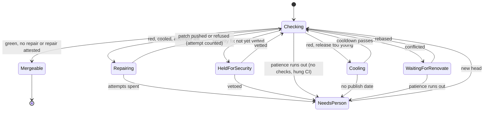

# State machine recommendations, 2026-11-09

What to do about the implicit state machines found in [the framework audit](2026-11-09-state-machines-almanac.md) and [the app audit](2026-11-09-state-machines-brined.md). Read those for the evidence. This doc only decides.

Changes to ivy/almanac go through proposals, so that half is written as issues to propose, in the order they should be proposed. The brined-almanac half is work this repo can do now.

## The decision

Every lifecycle gets four things, and nothing more elaborate than that:

1. **A name.** One enum per lifecycle, with every state it can really be in, including the failure ones. Where the state is stored, the column holds that enum, under a CHECK constraint. Where the state is recomputed from outside evidence (a pull request), one function computes it, and everything that needs it calls that function.
2. **An exit from every state that isn't final.** A timeout, an attempt cap, or an Ask. "Waiting" always says what it waits for and what happens if that never comes.
3. **A visible transition.** One structured log event with a stable diag code per transition, and one `status` view that reads states rather than reconstructing them.
4. **One transition table for the fake and the real thing.** A conformance suite per provider trait, run against both, so the fakes that principle 11 relies on run the same machine.

Why this one:

- **It serves all three readers.**
  - UX: a person on a pull request, or Josh at the terminal, sees the state and the next step.
  - DX: a developer reads one `match` to learn every way in and out, and illegal combinations stop compiling.
  - AX: an agent reads `status --format json` and stable codes, and can act without reading the source. That is principle 9 applied to state instead of errors.
- **It follows almanac's own grain.** `Admission`, `Claim`, `Age`/`Cooled` and `fleet::derive` already do this at the boundaries, and they are the best-tested code in the repo. This extends that style inward.

Rejected:

- **A state-machine crate** (statig, rust-fsm and the like). Principle 10 prefers a function to a framework, and `enum` + `match` + `#[non_exhaustive]` is enough.
- **TLA+ for everything.** Only the pull-request lifecycle has enough concurrency to earn a model (two workflows, Renovate, CI and a person all move it). Model that one with the `statechart` skill before it is coded, and nothing else.
- **A rewrite in one pass.** It would break things, and every bug here can be fixed on its own.

### How nothing breaks

- Write a characterization test for today's behaviour before changing it, and change the test in the same commit as the behaviour, saying why.
- Migrations only add columns and backfill them. No rename, no drop.
- A delivery id that has already been seen keeps its exact spelling, so nothing files twice.
- One behaviour change per proposal or commit, each proven by a dry run against a copy of prod (the runbook's preview-on-a-copy) before it ships.

## brined-almanac: do now

In order. Each one is small, app-owned, and needs nothing from upstream.

### 1. `cluster-below-state`: let a quiet cluster be looked at again

The headline bug: a cluster first seen below its threshold is sealed for the day. Fix it with the framework's own tool, applied to quiet clusters only:

```rust
let scanned = Scanned::new(key.delivery_id(), payload);
if c.count < class_named(key.class).threshold {
    scanned.at_state("below")   // id becomes scan:brent/…/{day}~below
} else {
    scanned                     // id unchanged, so already-filed clusters stay duplicates
}
```

- **Why only quiet clusters get a suffix:** a cluster that has already filed keeps today's id and stays a duplicate, so the change files nothing twice. While a cluster is still below threshold, each scan sees the `~below` id as a duplicate and costs nothing. The first scan after it crosses emits the bare id, which is new for that cluster, and it files once.
- **What it costs:** for the rest of deploy day, a cluster that was sealed quiet under the old bare id stays sealed. Deploy early in the cluster's day, or accept that.
- **Threshold changes come out right:** lowering a threshold makes a cluster cross, which gives it a new id, so it files. Raising one gives a `~below` id, which runs `Quiet`. Both are correct.
- **The threshold check moves to `scan`.** `facts()` still decides, and the run log still records quiet runs, because they are still events. Update the spec's Dedupe section, which says thresholds live only in gather.
- **Tests:**
  - a cluster scanned at 2 (quiet), then at 3 (files once), then at 4 (duplicate);
  - the existing double-scan test, still all duplicates.
- **UX:** issues that should exist now get filed.
- **DX:** the id states its rule.
- **AX:** the run log has one quiet run per scan in which the cluster was below threshold, and one loud run.

### 2. `mode-guard`: prod can't be dry by accident

- `scripts/deploy` refuses to deploy unless the prod env has `ALMANAC_MODE=live`.
- `scripts/compose-config-check` stops supplying `ALMANAC_MODE` itself, and fails when the real env lacks it.
- `main.rs` logs one line at startup with the effective mode and each tracker side. For example: `mode=live issues=github tasks=taskwarrior store=postgres`. Names only, never values.
- Nothing about a correct prod changes. A wrong one now fails at deploy instead of filing nothing for days.

### 3. `puller-honest-health`: healthy means pulling

- Write `.last-pull` only after a pass with no failed session and a readable cursors file. Also write `.last-pass` with `ok=N failed=N skipped=N`, and log the same counts as one line per pass.
- The compose health check stays as it is, and now means something: a session that fails every pass for 30 minutes turns the container unhealthy.
- This deliberately changes the "mid-stream last-pull present" test, so the commit has to say why.
- Before appending a fetch, check that the file ends in a newline, and add one if it doesn't, so a torn append can't fuse two events.
- The missing overlap window is only suspected. First write a test that adds an event stamped before the cursor after a pull. If it is lost, fetch from `cursor - overlap`. The reader already dedupes by event id, so the overlap costs bytes, not duplicate filings.

### 4. `worker-respawn`: a dead taskwarrior worker comes back

- On the request after a panic, start a fresh worker thread and reopen the replica, and log the old cause once. Today the worker answers every later request with its cause and never recovers.
- Check first that the replica's commit is transactional, so a panic mid-commit can't leave it half-written. If it isn't, keep the current behaviour and make the death visible instead: log it, and add it to the startup line's tracker side.

### 5. `deploy-promote-after-healthy`: `:prod` means it worked

- Build `:<sha>` only. Run `up --wait` on that tag, then `sync-check` and `healthz`, and only then retag `:prod`.
- Add `scripts/deploy --rollback <sha>`, which retags and runs `up`, with no build.
- A failed deploy leaves `:prod` on the last good build, which is what the runbook already assumes.

### Not now: an explicit cluster record

A stored cluster with a lifecycle (filed, recurring, resolved) is what vision.md's close and update ideas will need. Build it when the [Resolve effect proposal](https://github.com/ivy/almanac/issues/6) lands, not before. Until then, the issue really is a snapshot.

## ivy/almanac: proposals, in order

Each is one issue. Visibility comes first, because it can't break anything and every later change gets checked through it. Each proposal brings its own conformance cases (rule 4), so there's no separate "fix the fakes" issue.

| # | Slug | Problem it ends | Depends on |
|---|---|---|---|
| 1 | `status-and-transitions` | the daemon can't see its own states | |
| 2 | `outbox-terminal` | terminal entries can change, and give-ups are silent | 1 |
| 3 | `run-outcomes` | runs stuck `running`, poison payloads, requeues that pay twice | 1 |
| 4 | `ledger-counts-outcomes` | attempts counted from plans, and stringly typed | 2 |
| 5 | `pr-phase` | the Renovate PR lifecycle's dead ends, loops, and trust races | 3, 4 |
| 6 | `sandbox-owned-from-create` | leaked containers, no reaper, a fake that can't fail | |
| 7 | `simforge-transitions` | the forge races and ambiguous writes no test can reach | |

### 1. `status-and-transitions`

- **Proposal:** `almanac status [--format json]` reads the states directly:
  - running runs, with their age;
  - held and pending events;
  - pending and failed outbox entries, with `last_error`;
  - tripped budgets;
  - dropped deliveries by reason (echo, chain stopped, unrouted, rejected).
- **Transitions get logged:** emit one `tracing` event per transition, each with a diag code: `run.started`, `run.failed`, `effect.gave_up`, `chain.stopped`, `budget.tripped`, `delivery.dropped`.
- **The consumer logs what it drops:** it stops discarding the `ingest()` and `settle()` results (`consumer.rs:256,281`), and it logs skipped unparseable bodies.
- **The "running" line names the mode.**
- **Unknown `ALMANAC_MODE` values:** this is the one behaviour change in the proposal. `live`, `dry-run` and unset are accepted, and anything else is a principle 9 error. Propose it as its own opt-in item so Ivy can say no to it separately.
- **`--format json` outcomes** become structured, not `Debug` strings.
- **For brined:** this is what makes sealed and abandoned clusters visible without a bespoke app feature.

### 2. `outbox-terminal`

- **Proposal:**
  - Guard both updates with `AND status = 'pending'` (`postgres.rs:543-578`), and make both stores call one shared `next_status(entry, result, give_up)`.
  - Back off between attempts.
  - On give-up, log `effect.gave_up`. With an alerts target, also ask, through the same route as the budget alert.
- **Compatibility:** an entry that is still pending behaves the same. Only a late write to a terminal entry changes, and it now does nothing.
- **Conformance:** a late success after `failed`, a late failure after `applied`, and give-up parity between the stores.

### 3. `run-outcomes`

- **Proposal:**
  - Add an outcome to `runs`: ran, stopped, or failed, plus a reason.
  - Add an `interrupts` counter carried across `recover`. After N interrupts, the run fails and asks, which is principle 6's attempt cap applied to crashes.
  - When a store call fails after a claim, the worker marks the run interrupted on a best-effort path, and `follow`'s reconnect path recovers this process's own stale runs, not only at startup.
  - A requeued run carries the previous run id, so its `run_log` recordings are reused and the model isn't paid twice (principle 7).
  - `release` checks `rows_affected`.
- **Compatibility:** the migration only adds columns, and existing `finished` rows backfill as `ran`.
- **Two daemons:** an owner column on running runs is the fix, but only if Ivy wants more than one daemon supported. Ask in the issue, and don't build it unasked.
- **Tests:**
  - a DB cut mid-run, where today's outage test only cuts it while idle;
  - a poison payload that stops after N interrupts;
  - a requeue that reuses its recording.

### 4. `ledger-counts-outcomes`

- **Proposal:**
  - Write `Push` and `Ask` traces when the outbox applies the effect, not when the run ends. Or count applied outbox entries directly. Ivy should pick whichever fits the store.
  - Type the trace kind. A unit variant's `Debug` output already equals its serde name, so the stored values don't change.
- **Compatibility:** a refused push stops costing an attempt, and an ask that failed delivery stops suppressing the next one.
- **Test:** a push refused five times leaves `attempts.used == 0`.

### 5. `pr-phase`

The big one. Model it first: write the lifecycle as a TLA+ spec with the `statechart` skill, with these rules as invariants:

- a vetoed security fix is never attested `success`;
- every phase except Merged and Closed has a step out;
- a person is asked at most once per question per head.

Bring the chart and the model's counterexamples to the issue. Then:

- **One `PrPhase`**, computed by one function from the evidence `fleet::derive` already reads. Both workflows and `almanac report` use it, and `derive` becomes that function.
- **Attempts come from trailers on the branch** (what `derive` counts), not from ledger rows keyed by branch name. That also fixes a new update on an old branch name inheriting the old count.
- **Refused repairs count** toward the cap, so the refusal loop ends.
- **Asks dedupe per (pull, question kind)**, via a stable effect key instead of `{run_id}:{i}`. So "younger than the cooldown" no longer silences a later real refusal.
- **Trust has precedence.** `build_failures` reads trust before it holds, and never overwrites a `failure` it didn't place. The hold and the attest use the same head.
- **Every waiting phase has patience**, like `security_fixes`' `CI_PATIENCE`: a patched head with no checks, a CI run that hangs, a conflict Renovate won't rebase. Each one asks a person when its patience runs out.
- **The phase is visible on GitHub.** The status description carries the phase (`repairing`, `waiting for Renovate to rebase`, `cooling until <date>`), so a person on the pull request reads the state without anyone being asked. The Exhausted ask says what the three attempts tried, not an empty body.
- **`Facts::Nothing` splits** into its four reasons, so the run log says which one applied.



Split it across several issues if Ivy prefers: attempts and ask dedupe first (they need 4), then trust precedence, then patience and the visible phase.

### 6. `sandbox-owned-from-create`

- **Proposal:**
  - `create` returns an owning guard as soon as `podman run` succeeds, so a failed or cancelled readiness step stops the container.
  - Containers carry `--label almanac.run=<run id>`, and the daemon reaps labelled containers that no live run owns at startup.
  - `destroy` is idempotent.
  - A destroy failure after a successful run is logged, and the run's result is kept.
  - Timeout versus OOM is read from `podman inspect` (`OOMKilled`), not from exit code 137.
  - The sum of the phase timeouts is checked against the sandbox lifetime.
- **Conformance:** one suite for the `Sandbox` trait, run against `FakeSandbox` and podman. It makes the fake honour unknown-id destroy, the exec timeout, and a create that can fail.

### 7. `simforge-transitions`

- **Proposal:**
  - `update_ref` honours `force: false` and returns GitHub's 422 on a non-fast-forward update.
  - Commits keep their parents.
  - A push emits `synchronize` and a new check suite.
  - Pull requests and issues can be closed and merged.
  - A failure mode applies the write and then loses the response.
  - Installation tokens can expire.
- **Why:** these are the transitions that the forge's race defence, every retried POST, and the tracker's closed-issue rule depend on, and today no test can reach them.

## What this leaves out

- **Nothing was run.** The **suspected** items in the audits need a repro before they go in a proposal:
  - the admit-versus-claim race;
  - trust overwrites between the two workflows;
  - the puller's overlap loss;
  - grace expiry.
  `pr-phase`'s TLA+ model is the cheapest repro for the trust race.
- **Scope.** The GitHub client's 401 handling, foreign-host pagination, and the redelivery sweep's missing cap are real gaps, but they are single-function fixes, not state machines. Each can be its own small issue whenever it's convenient.
- **Pruning.** `seen`, `ledger`, `runs` and `run_log` grow forever. That's a retention decision for Ivy, not a lifecycle bug.
